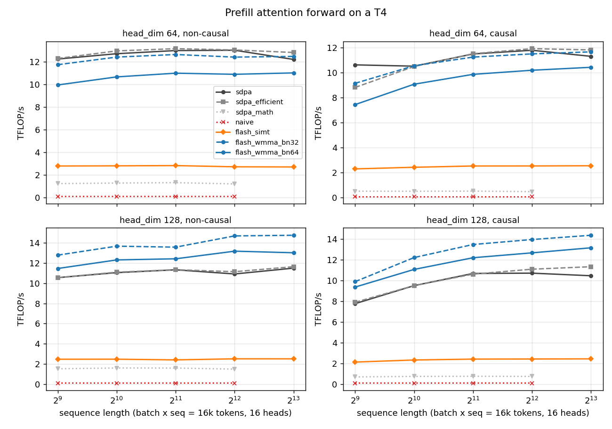
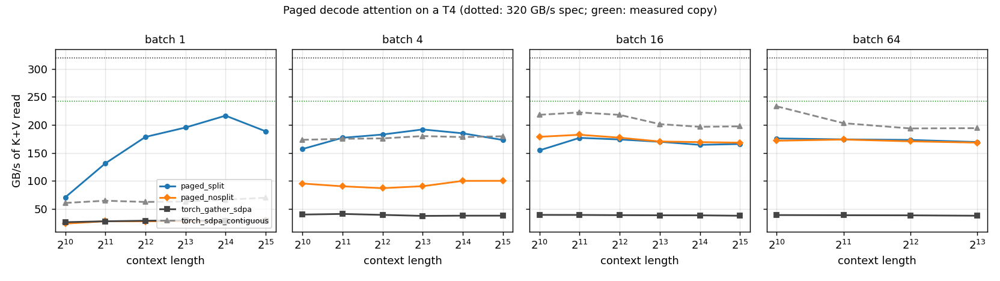
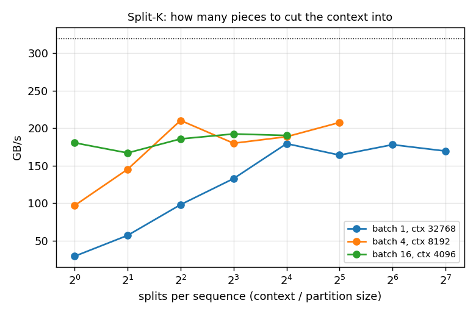
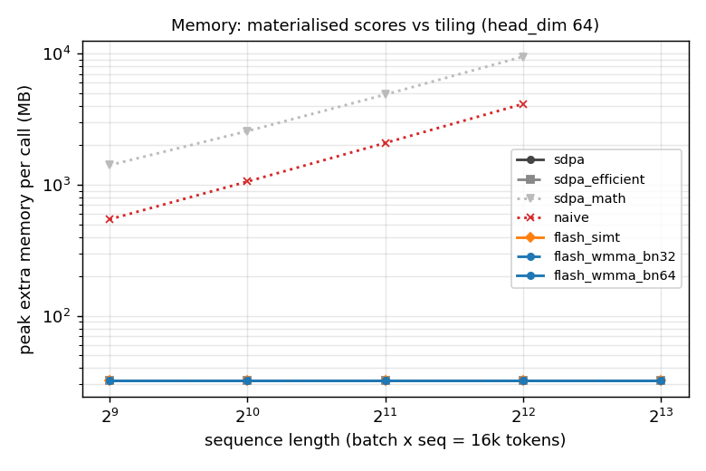

# flash-attention-from-scratch

Attention kernels for LLM inference, written by hand in CUDA C++ and measured
on an NVIDIA T4:

- **prefill**: a naive three-kernel reference, a FlashAttention-style tiled
  kernel with online softmax on CUDA cores, and the same algorithm on tensor
  cores through WMMA;
- **decode**: attention over a vLLM-style paged KV cache, with split-K
  ("flash-decoding") parallelism over the context and a reduce kernel.

Everything is exposed to PyTorch as an extension, checked against an fp32
reference with pytest, and benchmarked against
`torch.nn.functional.scaled_dot_product_attention` (SDPA). This README is
written as a short report: why the kernels look the way they do, what they
measure, and where PyTorch is still faster.

## Contents

1. [Why attention needs its own kernels](#why-attention-needs-its-own-kernels)
2. [Online softmax in a few lines](#online-softmax-in-a-few-lines)
3. [The kernels](#the-kernels)
4. [Results on a T4](#results-on-a-t4)
5. [Where PyTorch wins, and why](#where-pytorch-wins-and-why)
6. [Limitations](#limitations)
7. [What would change on Ampere and Hopper](#what-would-change-on-ampere-and-hopper)
8. [Reproducing](#reproducing)

## Why attention needs its own kernels

For one head, attention is `O = softmax(Q K^T / sqrt(d)) V` with Q, K, V of
shape N x d. Written as three PyTorch ops it is two matrix multiplies and a
softmax, and that is exactly what the naive kernel here does. The problem is
the middle tensor. `S = Q K^T` is N x N: at N = 8192 it is 64 M entries per
head, 256 MB in fp32, for a result O that is only 1 MB (fp16, d = 64).

Count the DRAM traffic. The matrix multiplies do 4 N^2 d FLOPs in total. The
naive version writes S, reads it back for the softmax, writes P, and reads P
again for P V: about 4 N^2 values moved for those FLOPs. With d = 64 that is
roughly 64 FLOPs per fp32 value moved, 16 FLOPs per byte. A T4 does about
65 TFLOP/s on fp16 tensor cores but only moves about 320 GB/s, so to keep the
tensor cores busy a kernel needs about 200 FLOPs per byte. The naive
version is memory-bound by more than 10x, and it also needs O(N^2) memory.

FlashAttention (Dao et al., 2022) removes the N x N tensor. It tiles Q into
blocks of rows and streams K and V through on-chip memory in blocks of
columns, so S only ever exists one tile at a time in shared memory and
registers. DRAM traffic drops to reading Q, K, V once per query block and
writing O once. The catch is the softmax: each output row needs the max and
the sum over the *whole* row of S, which is not known until the last tile.
Online softmax solves that.

Decode is a different regime. One new token per sequence means Q is a single
row, so there are only about 2 FLOPs per K/V element read. No amount of
tiling makes that compute-bound: the best a decode kernel can do is stream
the KV cache at close to DRAM bandwidth, which is why the decode results
below are in GB/s, not TFLOP/s.

## Online softmax in a few lines

For one query row with scores s_1 ... s_N, the output is

    o = sum_j exp(s_j - m) v_j / l,   m = max_j s_j,   l = sum_j exp(s_j - m)

(subtracting m changes nothing mathematically and keeps exp from
overflowing). Process the keys in blocks. Keep a running max m, a running
sum l and an unnormalised accumulator a. When block B arrives with scores
s_B:

    m' = max(m, max(s_B))
    l' = l * exp(m - m') + sum_{j in B} exp(s_j - m')
    a' = a * exp(m - m') + sum_{j in B} exp(s_j - m') v_j

Every earlier term in l and a was computed relative to m; multiplying by
exp(m - m') moves it to the new reference m', so after the last block
`a / l` is exactly the softmax-weighted sum. The cost is one rescale of the
accumulator per block. Two partial results (m1, l1, a1) and (m2, l2, a2) merge
the same way, which is what the split-K decode reduce kernel does.

All kernels here work in base 2: `exp(x) = exp2(x * log2 e)`, with
`1/sqrt(d) * log2 e` folded into one multiply, because `exp2` is a single
hardware instruction (MUFU.EX2).

## The kernels

All kernels take fp16 Q, K, V and accumulate in fp32. Layout is
`[batch, heads, seq, head_dim]`, head_dim 64 or 128, causal or not. Sources are
in [attnkernels/csrc](attnkernels/csrc).

### Naive ([naive_attn.cu](attnkernels/csrc/naive_attn.cu))

Three kernels: one thread per score for `S = scale * Q K^T` (fp32, written to
DRAM), one block per row for an in-place softmax, one thread per output
element for `O = P V`. It is the honest "what the math says" baseline, and
it is the version that runs out of memory first.

### Tiled, CUDA cores ([flash_simt.cu](attnkernels/csrc/flash_simt.cu))

One block of 256 threads owns 64 query rows of one (batch, head). The Q tile
sits in shared memory for the whole kernel. For each key tile (64 keys for
d = 64, 32 for d = 128, to stay under 48 KB of shared memory) the block loads
K transposed and V into shared memory, then:

1. computes its 64 x BC block of scores; threads form a 16 x 16 grid and
   each holds a 4 x (BC/16) register tile;
2. updates the running max and sum; the 16 threads that share a row are 16
   consecutive lanes, so a row reduction is 4 `__shfl_xor_sync` steps;
3. rescales its slice of O (4 rows x d/16 dims, in registers) and adds P V,
   with P going through shared memory.

Causal masking skips key tiles entirely above the diagonal and masks inside
the diagonal tile. Rows and keys past the end of an odd-length sequence are
zero-filled and masked.

### Tiled, tensor cores ([flash_wmma.cu](attnkernels/csrc/flash_wmma.cu))

Same algorithm with the two matrix products on tensor cores through the
WMMA API (16 x 16 x 16 fp16 fragments, fp32 accumulators), which is the
tensor-core interface sm_75 supports. A block has 4 warps and 64 query rows,
16 per warp, so no softmax row is shared between warps:

- each warp's 16 x d slice of Q is loaded once into WMMA A-fragments and stays
  in registers;
- its 16 x d slice of O lives in fp32 accumulator fragments;
- the K and V tiles (BC x d) are shared by the 4 warps in shared memory.

Per key tile a warp computes `S = Q K^T` (16 x BC) on tensor cores, stores it
to a per-warp scratch buffer, does the online-softmax update there (two lanes
per row, one shuffle per reduction), writes P back as fp16 *in place*, loads
P as A-fragments and accumulates `O += P V` on tensor cores.

One detail took some thought. Rescaling O by `exp(m - m')` is per row, but
CUDA does not specify which matrix element each thread holds in an
accumulator fragment. Instead of hard-coding an architecture's layout, every
warp loads a 16 x 16 matrix with entry (r, c) = r into an accumulator
fragment once at the start; element i of that fragment then *is* the row of
element i in every accumulator fragment of the same type. Rescaling becomes
`o.x[i] *= alpha[row[i]]`, portable across GPUs.

The key-tile width BC is a template parameter (32 or 64); both are measured.
BC = 64 halves the number of block-wide syncs but uses more shared memory,
which on Turing (64 KB per SM) means fewer resident blocks.

### Paged decode ([paged_decode.cu](attnkernels/csrc/paged_decode.cu))

The KV cache is a pool of fixed-size blocks,
`k_cache, v_cache: [num_blocks, kv_heads, block_size, head_dim]`, and each
sequence has a block table mapping its logical block i to a physical block,
like vLLM's PagedAttention. Context lengths differ per sequence.

With one query token per sequence, a batch of 4 sequences with 8 kv heads is
only 32 (sequence, head) pairs: not enough thread blocks for 40 SMs, and each
block would walk a 32k-token context alone. Split-K (Dao et al.'s
flash-decoding) cuts the context into partitions and runs one block per
(partition, kv head, sequence). Each block writes its partial output
(normalised by its own sum) together with its max and sum; a second kernel
merges the partials with weights `l_s * exp(m_s - max_s m_s)`. The
partition size is chosen so the grid has about 4 blocks per SM, never less
than one 256-token chunk per split.

Inside a block:

- grouped-query attention is handled by giving one block all G query heads
  that share a kv head, so each K/V byte is read once (G = 4 for the
  Llama-3-8B shape benchmarked: 32 query heads, 8 kv heads);
- scores: 8 lanes per token, 16-byte loads (a 128-dim fp16 key is two
  128-byte coalesced rows per 8 lanes), 3 shuffles per dot product;
- the partition is processed in 256-token chunks with online softmax
  between chunks, so any partition size works with a fixed 20 KB of shared
  memory;
- `P V`: d/8 threads cover one V row with 16-byte loads, the remaining
  threads take other tokens, and partial sums are reduced with shuffles and
  shared memory at the end.

## Results on a T4

One full run on a Kaggle T4 (2026-10-19): prefill from 512 to 8192 tokens with
batch x sequence fixed at 16k tokens, decode from 1k to 32k context at batch
1, 4, 16 and 64, a split-size sweep, and a ragged batch. Every table is
generated by [bench/report.py](bench/report.py) from
[results/t4.json](results/t4.json); nothing is extrapolated. T4 timings on
Kaggle move by up to about 30% between sessions (an earlier short run had
SDPA at 13 to 15 TFLOP/s where this one has 11 to 13), so compare
implementations within one run.

### Summary

- **Correctness.** 192 pytest cases pass against an fp32 reference, including
  causal masks, odd lengths and ragged paged batches
  ([results/pytest.txt](results/pytest.txt)). The worst prefill error is
  9.92e-4, the same as PyTorch's own SDPA.
- **On a T4, PyTorch has no FlashAttention.** SDPA reports FLASH_ATTENTION and
  CUDNN_ATTENTION as unavailable on sm_75 and runs its memory-efficient
  kernel, so that is the real comparison. Below, "SDPA" means the faster of
  SDPA's default and its memory-efficient backend in each row.
- **Prefill, head_dim 128: the WMMA kernel beats PyTorch at every length.**
  12.8 to 14.7 TFLOP/s non-causal against 10.6 to 11.6 (1.20x to 1.32x), and
  9.9 to 14.4 causal against 7.9 to 11.3 (1.25x to 1.28x).
- **Prefill, head_dim 64: level with PyTorch, not ahead.** Non-causal the
  WMMA kernel is 3 to 5% slower; causal it ties at 1024 tokens, is 1 to 4%
  slower from 2048 up, and 14% slower at 512.
- **Memory.** The tiled kernels need only the output (32 to 64 MB here), like
  SDPA. The naive version needs up to 4.2 GB and SDPA's math backend up to
  9.7 GB at 4096 tokens; both run out of memory at 8192.
- **Tensor cores are the whole story.** The same online-softmax algorithm on
  CUDA cores (flash_simt) reaches 2.1 to 2.8 TFLOP/s; on tensor cores, 7.4 to
  14.7. The naive three-kernel version manages 0.1 TFLOP/s.
- **Decode, one sequence: split-K is what makes it fast.** The split kernel
  reads the KV cache at 179 to 217 GB/s from 4k to 32k tokens, up to 89% of
  the 243 GB/s the T4 reached in a plain copy. At 32k that is 0.71 ms per
  token step, 2.7x faster than SDPA on a contiguous cache and 6.5x faster
  than gathering the pages and calling SDPA. Without split-K the same kernel
  stays at about 29 GB/s: 8 thread blocks cannot fill 40 SMs.
- **Decode, batch 4: level with PyTorch on a contiguous cache** (within about
  10% either way, depending on context length).
- **Decode, batch 16 and 64: PyTorch on a contiguous cache is faster**, by 12
  to 33%. Against the fair paged baseline (gather the pages, then SDPA) the
  paged kernel is 4.4 to 4.6x faster.
- **Ragged batch** (16 sequences, mean 14.7k, max 31.7k tokens): 157 GB/s of
  useful bytes with split-K, 8.2x the gather + SDPA route.
- **Split size.** At batch 1 and 32k context, partitions of 512 to 2048 tokens
  are best (about 178 GB/s); one partition gives 29 GB/s. At batch 16 the
  split hardly matters, because the batch already fills the GPU.



In the prefill chart the two tensor-core variants share a colour: dashed is
the 32-key tile (BC = 32), solid the 64-key tile. BC = 32 is faster in every
configuration.







GPU: Tesla T4 (sm_75, 40 SMs, 14.6 GB), driver 580.178.04, PyTorch 2.11.0+cu128, CUDA 12.8, measured 2026-10-19 18:24 UTC.

Measured ceilings: device-to-device copy 242.9 GB/s, fp16 GEMM 8192^3 (cuBLAS) 23.11 TFLOP/s.

SDPA backends on this GPU: FLASH_ATTENTION: unavailable, EFFICIENT_ATTENTION: ok, CUDNN_ATTENTION: unavailable, MATH: ok.

### Prefill TFLOP/s, head_dim 64, non-causal, 16 heads

| seq | batch | sdpa | sdpa_efficient | sdpa_math | naive | flash_simt | flash_wmma_bn32 | flash_wmma_bn64 |
|---|---|---:|---:|---:|---:|---:|---:|---:|
| 512 | 32 | 12.25 | 12.30 | 1.24 | 0.11 | 2.80 | 11.75 | 9.96 |
| 1024 | 16 | 12.72 | 12.97 | 1.29 | 0.11 | 2.81 | 12.43 | 10.68 |
| 2048 | 8 | 13.00 | 13.17 | 1.33 | 0.11 | 2.84 | 12.65 | 11.00 |
| 4096 | 4 | 13.03 | 13.06 | 1.22 | 0.11 | 2.73 | 12.42 | 10.90 |
| 8192 | 2 | 12.22 | 12.83 |  |  | 2.72 | 12.49 | 11.03 |

### Prefill TFLOP/s, head_dim 64, causal, 16 heads

| seq | batch | sdpa | sdpa_efficient | sdpa_math | naive | flash_simt | flash_wmma_bn32 | flash_wmma_bn64 |
|---|---|---:|---:|---:|---:|---:|---:|---:|
| 512 | 32 | 10.62 | 8.81 | 0.53 | 0.10 | 2.31 | 9.14 | 7.44 |
| 1024 | 16 | 10.51 | 10.49 | 0.52 | 0.10 | 2.44 | 10.55 | 9.07 |
| 2048 | 8 | 11.49 | 11.51 | 0.53 | 0.10 | 2.54 | 11.24 | 9.86 |
| 4096 | 4 | 11.78 | 11.91 | 0.49 | 0.10 | 2.54 | 11.49 | 10.19 |
| 8192 | 2 | 11.30 | 11.81 |  |  | 2.56 | 11.66 | 10.42 |

### Prefill TFLOP/s, head_dim 128, non-causal, 16 heads

| seq | batch | sdpa | sdpa_efficient | sdpa_math | naive | flash_simt | flash_wmma_bn32 | flash_wmma_bn64 |
|---|---|---:|---:|---:|---:|---:|---:|---:|
| 512 | 32 | 10.55 | 10.55 | 1.52 | 0.11 | 2.47 | 12.78 | 11.45 |
| 1024 | 16 | 11.04 | 11.09 | 1.60 | 0.11 | 2.47 | 13.67 | 12.30 |
| 2048 | 8 | 11.32 | 11.33 | 1.59 | 0.11 | 2.40 | 13.57 | 12.41 |
| 4096 | 4 | 10.91 | 11.14 | 1.49 | 0.11 | 2.51 | 14.68 | 13.17 |
| 8192 | 2 | 11.49 | 11.63 |  |  | 2.51 | 14.74 | 13.01 |

### Prefill TFLOP/s, head_dim 128, causal, 16 heads

| seq | batch | sdpa | sdpa_efficient | sdpa_math | naive | flash_simt | flash_wmma_bn32 | flash_wmma_bn64 |
|---|---|---:|---:|---:|---:|---:|---:|---:|
| 512 | 32 | 7.76 | 7.89 | 0.70 | 0.10 | 2.13 | 9.88 | 9.36 |
| 1024 | 16 | 9.50 | 9.50 | 0.74 | 0.10 | 2.33 | 12.20 | 11.06 |
| 2048 | 8 | 10.67 | 10.60 | 0.76 | 0.10 | 2.41 | 13.46 | 12.19 |
| 4096 | 4 | 10.70 | 11.08 | 0.74 | 0.10 | 2.42 | 13.94 | 12.66 |
| 8192 | 2 | 10.45 | 11.32 |  |  | 2.44 | 14.35 | 13.14 |

### Prefill peak extra memory (MB), head_dim 64, non-causal (includes the output)

| seq | batch | sdpa | sdpa_efficient | sdpa_math | naive | flash_simt | flash_wmma_bn32 | flash_wmma_bn64 |
|---|---|---:|---:|---:|---:|---:|---:|---:|
| 512 | 32 | 32 | 32 | 1408 | 544 | 32 | 32 | 32 |
| 1024 | 16 | 32 | 32 | 2560 | 1056 | 32 | 32 | 32 |
| 2048 | 8 | 32 | 32 | 4864 | 2080 | 32 | 32 | 32 |
| 4096 | 4 | 32 | 32 | 9472 | 4128 | 32 | 32 | 32 |
| 8192 | 2 | 32 | 32 |  |  | 32 | 32 | 32 |

### Prefill peak extra memory (MB), head_dim 128, non-causal (includes the output)

| seq | batch | sdpa | sdpa_efficient | sdpa_math | naive | flash_simt | flash_wmma_bn32 | flash_wmma_bn64 |
|---|---|---:|---:|---:|---:|---:|---:|---:|
| 512 | 32 | 64 | 64 | 1664 | 576 | 64 | 64 | 64 |
| 1024 | 16 | 64 | 64 | 2816 | 1088 | 64 | 64 | 64 |
| 2048 | 8 | 64 | 64 | 5120 | 2112 | 64 | 64 | 64 |
| 4096 | 4 | 64 | 64 | 9728 | 4160 | 64 | 64 | 64 |
| 8192 | 2 | 64 | 64 |  |  | 64 | 64 | 64 |

### Prefill max abs error vs fp32 (worst case over all shapes)

| impl | max abs error |
|---|---:|
| sdpa | 9.92e-04 |
| sdpa_efficient | 9.92e-04 |
| sdpa_math | 9.66e-04 |
| naive | 9.66e-04 |
| flash_simt | 9.69e-04 |
| flash_wmma_bn32 | 9.92e-04 |
| flash_wmma_bn64 | 9.92e-04 |

### Decode GB/s (K+V bytes / time), 32 query heads, 8 kv heads, head_dim 128

| batch | ctx | paged_split | paged_nosplit | torch_gather_sdpa | torch_sdpa_contiguous |
|---|---|---:|---:|---:|---:|
| 1 | 1024 | 70.8 | 23.9 | 26.5 | 60.8 |
| 1 | 2048 | 131.4 | 28.2 | 28.1 | 64.8 |
| 1 | 4096 | 178.6 | 28.0 | 29.1 | 62.6 |
| 1 | 8192 | 195.4 | 28.3 | 29.7 | 63.3 |
| 1 | 16384 | 216.6 | 28.6 | 28.7 | 66.6 |
| 1 | 32768 | 188.7 | 29.3 | 29.0 | 70.1 |
| 4 | 1024 | 157.0 | 95.5 | 40.1 | 173.5 |
| 4 | 2048 | 177.1 | 90.5 | 41.2 | 175.3 |
| 4 | 4096 | 182.9 | 87.2 | 39.5 | 176.0 |
| 4 | 8192 | 192.0 | 90.7 | 37.7 | 180.2 |
| 4 | 16384 | 185.1 | 100.2 | 38.1 | 178.4 |
| 4 | 32768 | 173.2 | 100.3 | 38.1 | 179.8 |
| 16 | 1024 | 154.7 | 178.9 | 39.5 | 218.1 |
| 16 | 2048 | 177.0 | 182.5 | 39.4 | 222.4 |
| 16 | 4096 | 174.1 | 177.3 | 39.0 | 218.0 |
| 16 | 8192 | 170.0 | 170.5 | 38.8 | 201.5 |
| 16 | 16384 | 164.5 | 169.4 | 38.7 | 196.7 |
| 16 | 32768 | 166.0 | 168.4 | 38.0 | 197.5 |
| 64 | 1024 | 175.9 | 171.8 | 39.2 | 233.3 |
| 64 | 2048 | 174.3 | 174.0 | 38.9 | 203.2 |
| 64 | 4096 | 173.3 | 170.8 | 38.7 | 193.8 |
| 64 | 8192 | 169.5 | 168.5 | 38.0 | 194.3 |

### Decode time (ms)

| batch | ctx | paged_split | paged_nosplit | torch_gather_sdpa | torch_sdpa_contiguous |
|---|---|---:|---:|---:|---:|
| 1 | 1024 | 0.0592 | 0.1758 | 0.1583 | 0.0690 |
| 1 | 2048 | 0.0639 | 0.2980 | 0.2987 | 0.1294 |
| 1 | 4096 | 0.0939 | 0.5999 | 0.5767 | 0.2679 |
| 1 | 8192 | 0.1718 | 1.1839 | 1.1282 | 0.5298 |
| 1 | 16384 | 0.3099 | 2.3429 | 2.3351 | 1.0076 |
| 1 | 32768 | 0.7111 | 4.5816 | 4.6312 | 1.9133 |
| 4 | 1024 | 0.1069 | 0.1757 | 0.4185 | 0.0967 |
| 4 | 2048 | 0.1895 | 0.3708 | 0.8150 | 0.1914 |
| 4 | 4096 | 0.3669 | 0.7694 | 1.6989 | 0.3814 |
| 4 | 8192 | 0.6989 | 1.4793 | 3.5627 | 0.7448 |
| 4 | 16384 | 1.4505 | 2.6801 | 7.0475 | 1.5047 |
| 4 | 32768 | 3.1001 | 5.3520 | 14.0925 | 2.9865 |
| 16 | 1024 | 0.4338 | 0.3751 | 1.6973 | 0.3077 |
| 16 | 2048 | 0.7584 | 0.7354 | 3.4028 | 0.6034 |
| 16 | 4096 | 1.5422 | 1.5142 | 6.8844 | 1.2313 |
| 16 | 8192 | 3.1586 | 3.1488 | 13.8500 | 2.6639 |
| 16 | 16384 | 6.5260 | 6.3376 | 27.7803 | 5.4588 |
| 16 | 32768 | 12.9390 | 12.7503 | 56.5262 | 10.8758 |
| 64 | 1024 | 1.5264 | 1.5626 | 6.8548 | 1.1504 |
| 64 | 2048 | 3.0794 | 3.0851 | 13.7967 | 2.6420 |
| 64 | 4096 | 6.1970 | 6.2860 | 27.7340 | 5.5399 |
| 64 | 8192 | 12.6721 | 12.7420 | 56.5763 | 11.0529 |

### Split-K partition size

| batch | ctx | partition | splits | blocks | ms | GB/s |
|---|---|---:|---:|---:|---:|---:|
| 1 | 32768 | 256 | 128 | 1024 | 0.7918 | 169.5 |
| 1 | 32768 | 512 | 64 | 512 | 0.7541 | 178.0 |
| 1 | 32768 | 1024 | 32 | 256 | 0.8178 | 164.1 |
| 1 | 32768 | 2048 | 16 | 128 | 0.7483 | 179.4 |
| 1 | 32768 | 4096 | 8 | 64 | 1.0109 | 132.8 |
| 1 | 32768 | 8192 | 4 | 32 | 1.3675 | 98.1 |
| 1 | 32768 | 16384 | 2 | 16 | 2.3525 | 57.1 |
| 1 | 32768 | 32768 | 1 | 8 | 4.5800 | 29.3 |
| 4 | 8192 | 256 | 32 | 1024 | 0.6467 | 207.6 |
| 4 | 8192 | 512 | 16 | 512 | 0.7116 | 188.6 |
| 4 | 8192 | 1024 | 8 | 256 | 0.7460 | 179.9 |
| 4 | 8192 | 2048 | 4 | 128 | 0.6382 | 210.3 |
| 4 | 8192 | 4096 | 2 | 64 | 0.9241 | 145.2 |
| 4 | 8192 | 8192 | 1 | 32 | 1.3846 | 96.9 |
| 16 | 4096 | 256 | 16 | 2048 | 1.4103 | 190.3 |
| 16 | 4096 | 512 | 8 | 1024 | 1.3957 | 192.3 |
| 16 | 4096 | 1024 | 4 | 512 | 1.4456 | 185.7 |
| 16 | 4096 | 2048 | 2 | 256 | 1.6078 | 167.0 |
| 16 | 4096 | 4096 | 1 | 128 | 1.4871 | 180.5 |

### Ragged batch: 16 sequences, mean context 14722, max 31683

| impl | ms | GB/s (useful bytes) |
|---|---:|---:|
| paged_split | 6.1552 | 156.7 |
| paged_nosplit | 6.9145 | 139.5 |
| torch_gather_sdpa | 50.7266 | 19.0 |

## Where PyTorch wins, and why

- **head_dim 64 prefill.** With d = 64 each K/V tile carries half the math of
  d = 128 for the same number of block-wide syncs and softmax updates, so the
  fixed per-tile overhead weighs more. PyTorch's memory-efficient kernel
  (from xformers/CUTLASS) pipelines its loads and uses tile shapes tuned per
  head size; mine use one tile shape for both. BC = 64 was meant to help and
  does not: on Turing the extra shared memory costs resident blocks.
- **Causal prefill at 512 tokens, d = 64.** The tiled kernel stops at the
  diagonal and lets a warp skip a tile that is fully masked for its rows, but
  diagonal tiles still run the full WMMA multiply and apply the mask
  afterwards. Warps that skip a tile still wait at the block-wide syncs, and
  blocks for early query rows finish long before blocks for late rows. Short
  sequences have proportionally more diagonal tiles, which fits the 14% gap at
  512 shrinking to 1% at 8192. I have not profiled it to confirm.
- **Decode with many sequences on a contiguous cache.** With 16 or 64
  sequences x 8 kv heads there is already enough parallelism, so split-K only
  adds a reduce pass, and SDPA on a flat cache gets long, perfectly coalesced
  reads with no block-table indirection. The paged layout exists to stop
  memory fragmentation under real serving load, which this benchmark does not
  measure.

## Limitations

- **Forward pass only.** No backward pass, so this is for inference, not training.
- **fp16 only**, head_dim 64 and 128, no dropout, no ALiBi or sliding window.
- **One GPU generation.** Tile sizes are tuned only for the T4 (sm_75, 64 KB shared memory per SM).
- **One run per configuration**, no error bars; Kaggle T4s vary by up to 30%
  between sessions.
- **The decode baselines are not paged.** `torch_sdpa_contiguous` reads an
  ordinary contiguous cache, which a paged serving system does not have; it is
  there as a bandwidth reference, not as a like-for-like competitor.

## What would change on Ampere and Hopper

- **Ampere (sm_80+).** `cp.async` lets the next K/V tile load into shared
  memory while the current one is multiplied (double buffering without
  register staging). `ldmatrix` and `mma.sync` (m16n8k16) replace WMMA and
  give direct control of fragment layout. bf16 becomes available, and up to
  164 KB of shared memory per SM allows bigger tiles. This is roughly the
  step from this repo to FlashAttention-2.
- **Hopper (sm_90).** TMA moves whole tiles asynchronously; `wgmma` runs
  warp-group matrix multiplies; warp specialisation splits producer warps
  (loads) from consumer warps (math); FP8 roughly doubles throughput again.
  That is the FlashAttention-3 design.
- **Decode** changes less: it is bandwidth bound on every GPU, so the same
  split-K and grouped-query layout carries over, with wider loads and
  more SMs to fill.

## Reproducing

The Mac this was written on has no CUDA GPU, so GPU runs went through a
private Kaggle script kernel on the T4 accelerator.
[kaggle/make_kernel.py](kaggle/make_kernel.py) packs `attnkernels/`, `tests/`
and `bench/` into one `run.py`.

```
pip install kaggle
python kaggle/make_kernel.py --user <your-kaggle-username> [--quick]
kaggle kernels push -p kaggle/build
kaggle kernels output <your-kaggle-username>/flash-attention-from-scratch-bench -p kaggle/out
```

On a machine with a CUDA GPU, nvcc and ninja:

```
pip install torch pytest numpy matplotlib ninja
pytest -q tests
python bench/bench.py --out results/t4.json          # add --quick for the short run
python bench/report.py results/t4.json > results/t4.md
python bench/plots.py results/t4.json results/figures
```

## License

MIT, see [LICENSE](LICENSE).
